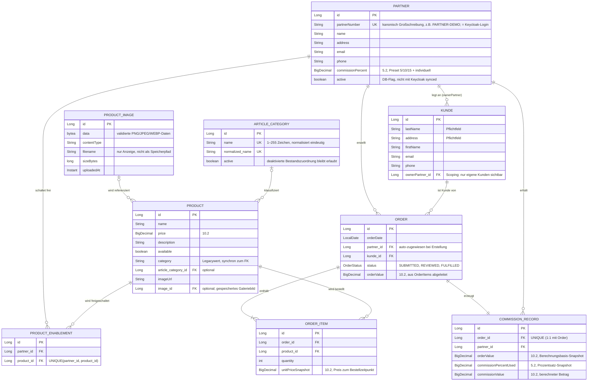

# Datenmodell — Partnerportal

ER-Diagramm und Entitätsbeschreibungen des fertigen Schemas (Phase 1–5). Rationale
hinter einzelnen Entscheidungen (z. B. kein `CommissionLevel`, Unit-Price-Snapshot)
steht in `openspec/changes/build-partnerportal-mvp/design.md` — hier nur das
Modell selbst.

## ER-Diagramm

`Order` mappt in der DB auf Tabelle `orders` (`ORDER` ist ein reserviertes
SQL-Wort in PostgreSQL) — siehe `docs/CONVENTIONS.md`.

## Entitäten im Detail

### Partner
Ein Vertriebspartner (Firma). `commissionPercent` ist ein einfaches numerisches
Feld (kein `CommissionLevel`), von der Firma per Dropdown (5/10/15 % oder
individueller Wert) gesetzt. `active` ist ein reines DB-Flag — Keycloak weiß
nichts von Aktiv/Inaktiv; `CurrentPartner.resolve()` prüft es serverseitig bei
jedem partnerbezogenen Request. Der Login-Link läuft über `partnerNumber`:
Keycloak-Logins werden manuell mit Benutzername = Partnernummer angelegt.
`partnerNumber` wird bei jedem Schreibzugriff (Anlage/Bearbeitung/Import) auf
Großschreibung kanonisiert, damit der case-sensitive DB-Unique-Constraint
Groß-/Kleinschreibungs-Duplikate wirklich verhindert; `resolve()` gleicht den
(von Keycloak kleingeschriebenen) Login-Claim großgeschrieben exakt gegen
`partnerNumber` ab. Ein Partner ohne passenden Keycloak-Login kann sich nicht
anmelden. Eine Änderung der Partnernummer ändert damit auch den Login — die
Firma wird im Bearbeiten-Formular entsprechend gewarnt.

### Product
Zentral von der Firma verwaltete Artikel. `available` steuert Bestellbarkeit
unabhängig von der partnerspezifischen Freischaltung (`ProductEnablement`) —
ein Produkt kann für einen Partner freigeschaltet, aber gerade nicht
verfügbar sein (z. B. ausverkauft); beides muss zutreffen, damit ein Partner
es bestellen kann. `articleCategory` ist eine optionale Zuordnung zu einer von
der Firma verwalteten Artikelkategorie. `category` bleibt als synchroner
Legacy-String für Import-/Bestandskompatibilität erhalten; neue Zuordnungen
verwenden eine Kategorie-ID oder den eindeutigen Legacy-Namen, niemals beides.
`imageUrl` bleibt für externe Bild-URLs erhalten; bei einem
hochgeladenen oder aus der Galerie gewählten Bild verweist `image` optional auf
einen gespeicherten `ProductImage`-Datensatz.

### ArticleCategory
Eine von der Firma verwaltete Artikelkategorie. `name` wird nach Trim und
Unicode-validierter Längenprüfung gespeichert; `normalized_name` ist
case-insensitive eindeutig. `active=false` verhindert neue Artikelzuordnungen
und Importzeilen, lässt bestehende Artikelzuordnungen aber unverändert. Es
gibt keinen DELETE-Endpunkt. Die additive ORM-Übernahme liest vorhandene
Legacy-Strings nach dem Seed, erstellt nur eindeutig belegte Kategorien und
bricht bei Kollisionen oder inkonsistentem FK ohne Teilübernahme ab.

### ProductImage
Ein serverseitig gespeichertes Artikelbild. Die binären Daten liegen direkt in
PostgreSQL als `bytea`; `contentType` wird aus dem Dateiinhalt validiert und
nicht aus dem Dateinamen übernommen. Der ursprüngliche UTF-8-Dateiname dient
nur zur Anzeige. Ein Bild kann von mehreren Artikeln aus der Galerie
wiederverwendet werden.

### ProductEnablement
Reine Zuordnungstabelle Partner × Product. Die Existenz einer Zeile bedeutet
„freigeschaltet"; Deaktivieren löscht die Zeile ersatzlos (kein Soft-Delete).

### Kunde
Der Endkunde, für den ein Partner bestellt. Wiederverwendbar über mehrere
Bestellungen hinweg. Pflicht: Nachname + Adresse; alles andere optional.
`ownerPartner` scoped den Datensatz auf den anlegenden Partner — ein Partner
sieht nie die Kunden eines anderen Partners; die Firma sieht Kundendaten nur
indirekt über die Bestelldetails.

### Order (Tabelle `orders`)
Eine Bestellung, automatisch dem erstellenden Partner zugewiesen (nie ein vom
Client mitgeschickter Wert). `orderValue` wird bei Erstellung aus den
`OrderItem`s berechnet und danach nicht mehr neu berechnet — ändert sich
später der Produktpreis, bleibt der historische Bestellwert unverändert.
Status-Workflow `SUBMITTED → REVIEWED → FULFILLED`, nur von der Firma
änderbar.

### OrderItem
Eine Bestellzeile (Artikel + Menge). `unitPriceSnapshot` speichert den
Produktpreis zum Bestellzeitpunkt — schützt historische Bestellungen und
Provisionen vor späteren zentralen Preisänderungen.

### CommissionRecord
Wird einmalig bei Bestellerstellung erzeugt (1:1 mit `Order`). Sowohl die
Berechnungsbasis (`orderValue`) als auch der verwendete Prozentsatz
(`commissionPercentUsed`) werden auf dem Record selbst gespeichert
(Snapshot) — eine spätere Änderung von `Partner.commissionPercent` verändert
keine bereits existierenden Provisionsdatensätze rückwirkend.

## Geld-Konvention
Alle Geldbeträge (`price`, `unitPriceSnapshot`, `orderValue`,
`commissionPercent`, `commissionPercentUsed`, `commissionValue`) sind
`java.math.BigDecimal` / SQL `numeric` — nie `double`/`float` (siehe
`docs/CONVENTIONS.md`).
